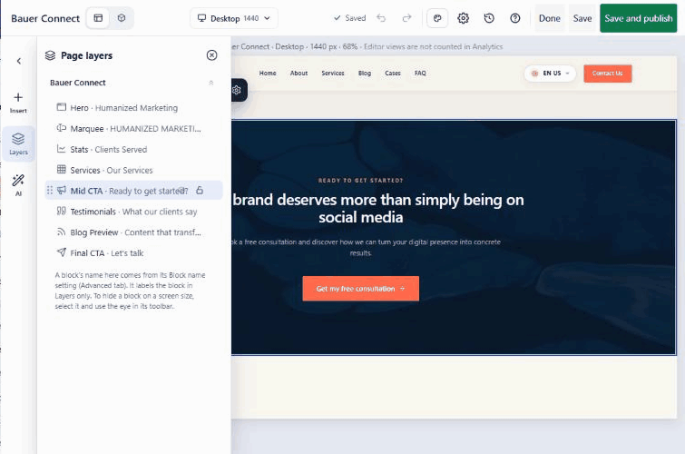
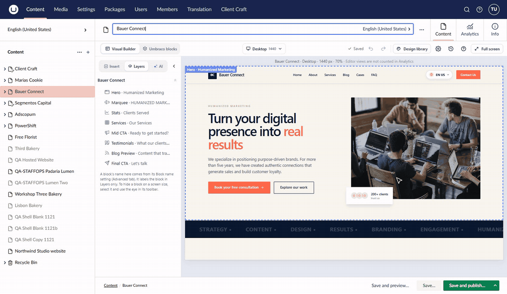
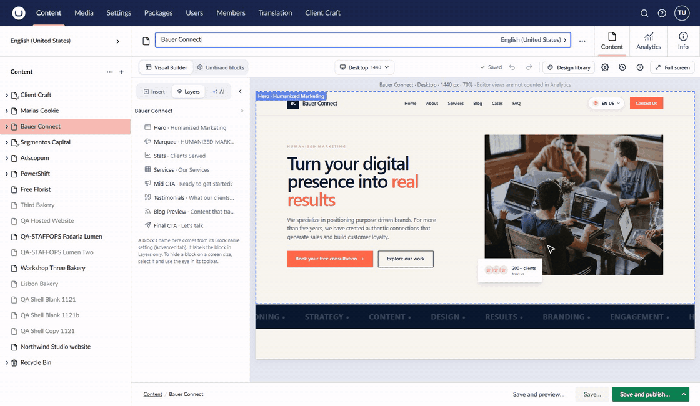
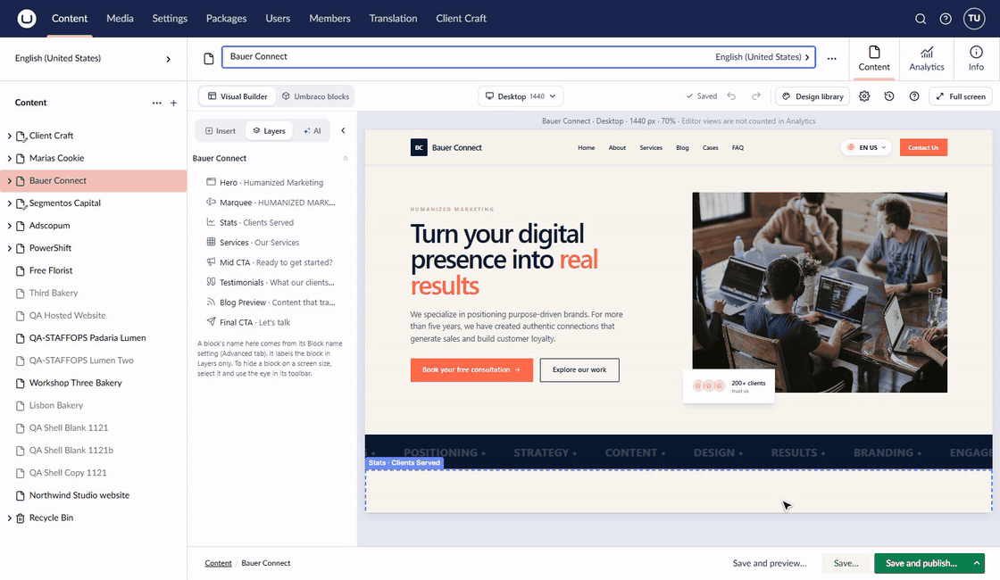
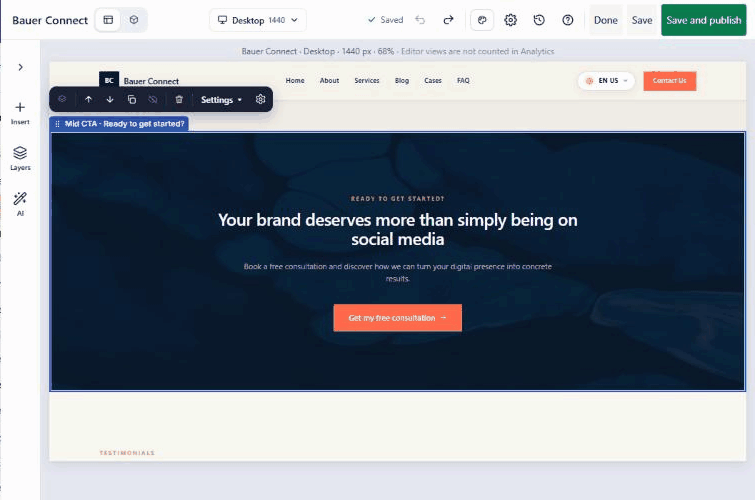
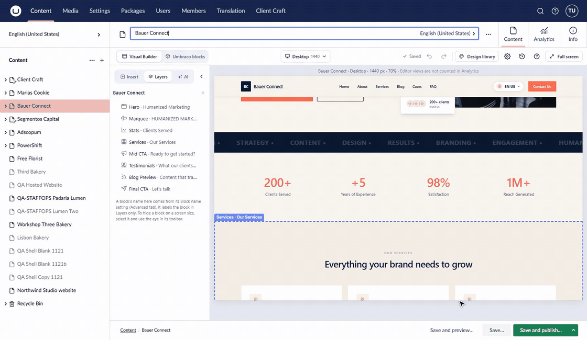
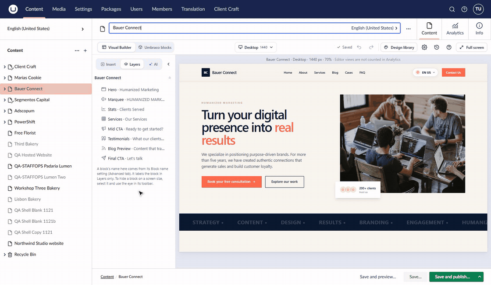
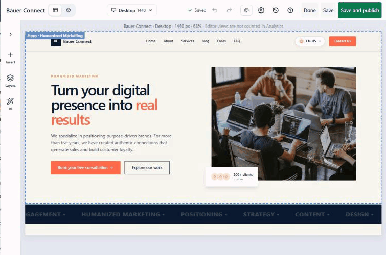

# Client Craft Visual Builder for Umbraco

**Edit your Umbraco pages the way they look.** Your real page, rendered by your own templates, becomes the editor. Click
a headline and type. Drag a section somewhere else. Restyle it for phones. Then press Umbraco's own **Save and publish**.

No new document types. No content migration. No lock-in. Your blocks, your templates, your data.


```bash
dotnet add package ClientCraft.VisualBuilder.Umbraco --prerelease
```

> **Public beta.** Running on real sites today. Tell us what works, what breaks and what you miss in
> [GitHub issues](https://github.com/ClientCraft/visual-builder/issues/new/choose). We read every one.

---

## Build in real time

The canvas is not a preview or a mock-up: it's your site, with its own CSS, fonts and scripts, rendered live inside the
backoffice. Open **Insert**, search your own block types (or saved patterns) and drag one onto the page. Fill in its
fields and the new section takes shape as you type. Only blocks your grid allows in that spot are offered, so editors
can't break your layout, and nothing is saved until you press Save.



## Type straight onto the page

Double-click any headline, label, paragraph or button text and just type. Press Enter (or click away) and the text is
written back to the right Umbraco property; Esc cancels and one undo puts it back. No forms, no hunting for the right
field.



## Change properties on the fly

Select a block and open its properties in a drawer, organised by your own Umbraco tabs. Change text, rich text, images,
links or toggles and watch the page update while you work. Fields the page doesn't show (a link URL, an alt text) are
one click away in the block toolbar's **Settings** menu.



## Every field mapped to its element, automatically

The Visual Builder reads your block data and matches each property to the element that shows it on the page, with no
markup changes needed. Select a block and hover: each field is outlined with its name. Double-click one to type, or to
jump straight to it in the drawer when it's rich text or media. Settings that only change a class can be pinned to an
element with one attribute: `data-property="alias"`.



## Move anything, easily

Grab a block by its handle and drag it where it belongs, across sections and grid areas. Or use the toolbar to move up,
move down, duplicate, hide or delete. Every step can be undone.



## See where it lands

While you drag or insert, the page dims and a blue line shows exactly where the block will drop, labelled with what
happens ("Move before Marquee", "Insert before Services"). Where your grid doesn't allow that block, the cue turns red
and says "Not allowed here". No more guessing inside nested grids.



## See every block in Layers

The Layers panel shows the whole page as a tree: sections, grid areas and the blocks inside them, named the way your
editors name them. Click to select and scroll to it, drag to reorder, lock what shouldn't move, and hide a block on one
screen size only.



## Every screen size

Switch between Desktop (1920 and 1440), Tablet and Phone, in portrait and landscape. Style each size separately: smaller
sizes inherit from larger ones until you change them, and a blue dot shows what was set where.



## One design library for the whole site

Colours, typography, spacing and radii live in one **design library**. Editors pick from it instead of typing hex codes,
so a brand change is one edit, not a hundred. Draft changes preview in the editor and go live when you publish styles,
and the library won't publish a deletion that pages still depend on.


- **Components:** turn a block into a reusable component; edit it once and every page that uses it updates.
- **Patterns:** save a group of blocks as a pattern and drop it into any page.
- **Custom code:** administrators can add site-wide CSS and JavaScript (JavaScript never runs inside the editor).

## Still 100% Umbraco

- **Umbraco's Save and publish.** The Visual Builder lives inside the document workspace; the footer, permissions,
  workflow, scheduling and version history are Umbraco's own.
- **Nothing happens behind your back.** Changes stay on the canvas until you save, and reach visitors only when you
  publish. Version history asks before replacing unsaved edits.
- **One click back.** The **Umbraco blocks** switch opens Umbraco's own Content view at any time.
- **Full screen when you want it.** Hide the backoffice chrome and edit edge to edge, with Save and publish kept at hand.

---

## Easy to extend

The Visual Builder works with the Block Grid and Block List types you already have. Open any page with a template and
it just works. Everything else is opt-in, in your code, and additive (content is never touched):

| Opt-in | Editors get | It adds |
|---|---|---|
| `.Styles(...)` | The Style tab with design-library values, per screen size | A "Visual styles" field on each block's settings |
| `.CollectionBlocks(...)` | A **Collection** block that repeats a template for every record of a data source, and a **Text** block | Two block types in the grids you list |
| `data-property="alias"` | A click target for settings that only change classes | Nothing: it's one HTML attribute |
| Your own data sources | Collection blocks fed by your own services | One class implementing `IVisualDataProvider` |

## Install

**Requirements:** .NET 10 and Umbraco 17.7.1 or later (below 18).

### 1. Add the package

```bash
dotnet add package ClientCraft.VisualBuilder.Umbraco --prerelease
```

Installing never takes over editing on its own. Switch the Visual Builder on in `appsettings.json`:

```json
{
  "ClientCraft": {
    "VisualBuilder": { "ActiveByDefault": true }
  }
}
```

Run the site and open any page in the backoffice: the Visual Builder opens instead of the Content view.

### 2. Turn on styles (optional, recommended)

Add a composer to any project the site references:

```csharp
using ClientCraft.VisualBuilder.Umbraco.Schema;
using Umbraco.Cms.Core.Composing;
using Umbraco.Cms.Core.DependencyInjection;

public sealed class VisualBuilderSetup : IComposer
{
    public void Compose(IUmbracoBuilder builder) => builder.AddVisualBuilderSite(site => site
        .Styles("Page Grid")             // your Block Grid data types, by name or key
        .CollectionBlocks("Page Grid")); // optional: Collection and Text blocks in these grids
}
```

On the next start the site adds only what is missing, then never again. With uSync, the new schema is exported like any
other change and reaches your other environments through your normal deployment.

### 3. Wrap your block views

One wrapper applies the block's styles, anchor id and custom classes, so your views never implement margins or padding:

```cshtml
@addTagHelper *, ClientCraft.VisualBuilder.Umbraco
@inherits Umbraco.Cms.Web.Common.Views.UmbracoViewPage<BlockGridItem<MyBlock>>

<ccvb-block block="Model" tag="section">
    <h2>@Model.Content.Title</h2>
    @Model.Content.Text
</ccvb-block>
```

Already have an outer element? Put `ccvb-style="Model"` on it instead. Blocks without styles render a plain element, so
the wrapper is safe everywhere.

### 4. Add one line to your layout

Anywhere inside your layout's `<head>`:

```cshtml
@await Html.VisualBuilder().RenderAssets()
```

It writes the page's Visual Builder styles and scripts and your site's custom CSS and JavaScript from the design
library. Pages without Visual Builder blocks get nothing. With the **ClientCraft** package you don't add it:
`@await Html.ClientCraft().RenderAssets()` already includes it.

---

## Build with AI and live data (with Client Craft)

Install the **ClientCraft** package (which includes the Visual Builder) to connect the site to a Client Craft workspace:

- **Build with AI:** describe a change ("add a pricing section with three plans") and it appears on the canvas as an
  unsaved change you review, keep or undo. Nothing is saved or published until you say so. Uses your workspace's AI
  credits.
- **Client Craft data sources:** Collection blocks can list your plans, prices and products straight from Client Craft.

The Visual Builder works fully without Client Craft. These features are shown as locked until it is installed.

## What it doesn't do

- It doesn't change your document types from the backoffice. Schema changes come only from your code.
- It doesn't save or publish on its own. Umbraco's Save and Publish are the only way changes leave the editor.
- It doesn't replace Umbraco. Every page can still be edited in Umbraco's own Content view.

## Beta notes

- Running on real sites on Umbraco 17.7 and 17.8, including sites built by other agencies with their own blocks.
- The backoffice editor is built for desktop screens.
- On our list: a publish summary dialog, editing the shared header and footer on the canvas, and version history inside
  the design library.

Feedback, bugs and ideas: [open an issue on GitHub](https://github.com/ClientCraft/visual-builder/issues/new/choose).

## License

MIT © Client Craft
